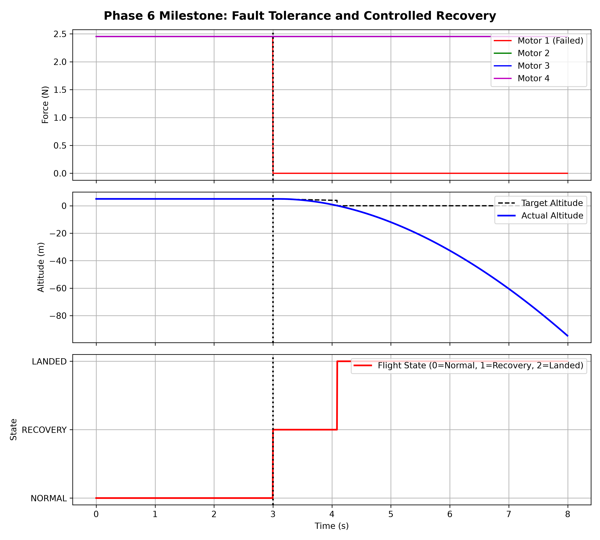

# Fault-Tolerant Quadcopter Flight Controller

A C++ simulation of a quadcopter that detects a failed motor in flight and executes a recovery state machine, instead of crashing blindly.

## 🚀 Project Overview
This project builds a 6-DOF rigid-body quadcopter simulation from scratch. It features cascaded PID control, sensor fusion, and a fault-tolerant supervisor that allows the drone to detect actuator failures and transition to a safe recovery state.

## 📊 Project Status

✅ **Phase 0: Setup and C++ Foundations** — *Complete*
- [x] Repository initialized and WSL2 environment configured
- [x] 1D Altitude PID Simulation

✅ **Phase 1: Rigid-body quadcopter model** — *Complete*
- [x] 6-DOF dynamics (Newton-Euler equations)
- [x] Quaternion integration for drift-free attitude
- [x] Motor mixer and thrust/torque mapping

✅ **Phase 2: Inner Loops (Rate & Attitude PID)** — *Complete*
- [x] Cascaded PID architecture with anti-windup
- [x] Validated 10-degree roll step response

✅ **Phase 3: Outer Loops and Disturbances** — *Complete*
- [x] Position controller for waypoint tracking
- [x] Wind gust injection and disturbance rejection

✅ **Phase 4: Sensors and State Estimation** — *Complete*
- [x] IMU sensor model with Gaussian noise
- [x] Complementary Filter for attitude estimation

✅ **Phase 5: Fault Detection and Isolation (FDI)** — *Complete*
- [x] Dynamic residual generator
- [x] Threshold-based fault triggering
- [x] Validated Motor 1 failure detection

✅ **Phase 6: Fault Tolerance and Recovery** — *Complete*
- [x] Supervisor State Machine (NORMAL -> RECOVERY -> LANDED)
- [x] Automated transition upon fault detection

*Figure 1: Supervisor State Machine successfully transitions to RECOVERY at t=3.0s upon detecting Motor 1 failure, and transitions to LANDED upon ground contact.*

## 🏗️ Architecture
- **`src/sim/`**: Physics engine, motor models, and wind disturbances.
- **`src/control/`**: Cascaded PID loops (Position, Attitude, Rate) and motor mixers.
- **`src/estimation/`**: IMU sensor models and Complementary/EKF filters.
- **`src/fdi/`**: Fault Detection and Isolation (residual-based).
- **`src/supervisor/`**: State machine (NORMAL, FAULT, RECOVERY, LANDED).

## 🛠️ Tech Stack
- **Language**: C++17
- **Math/Physics**: Eigen (Linear Algebra), Quaternions, Semi-Implicit Euler Integration
- **Build System**: CMake
- **Visualization**: Python (Matplotlib 3D & 2D)
